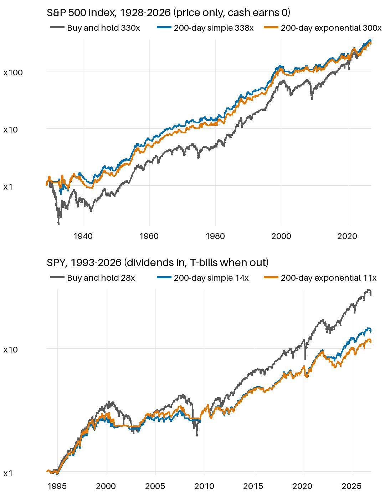

# Backtest of the two ideas Brian shared on 2026-11-28 (requests Task R5)

Sources: research-inbox items 14 and 16 (summary, transcript, and frames taken from item 14's
saved video; nothing fetched from Instagram). Script: `scripts/backtest_ma_rule.py`; test:
`tests/test_backtest_ma_rule.py`. Prices: the project's store (Yahoo daily), last day 2026-11-25.

## Verdicts

- **Item 14, the "screen line" rule.** It does not beat holding after costs. On the S&P 500 since
  1928 it ends level with holding (6.1% a year each) with a much smaller deepest fall. Since 1993,
  with dividends and T-bills, it earns 8.2% a year against 10.6%. That is not the "vast
  outperformance" the post claims.
- **Item 16, five GitHub repos for an "AI hedge fund".** It is not testable: the post names no
  trading rule, only tools (a data library, an agent framework, a broker link).

## Item 14: the rule as the post states it

What the post says (transcript): "buy above the [green] line and then sell below it on the
S&P 500". The transcript reads "screen line"; the video's chart shows a green line. The video's
own chart captions name it "THE 200-DAY RULE" and state its set-up: "$1,000 from 1926 · CRSP
total return · T-bills when out · no costs". The indicator it promotes is listed on TradingView as
"PlayBit EMA" (an exponential moving average; length not shown).

- **Instrument:** S&P 500.
- **Timeframe:** daily closes.
- **Entry:** the close is above the 200-day moving average → hold the index from the next day.
- **Exit:** the close is below it → hold cash (T-bills) from the next day.
- **Literal reading (tested as "simple"):** 200-day simple average, i.e. the plain mean of the
  last 200 closes.
- **Alternative (tested as "exponential"):** a 200-day exponential average, which weights recent
  days more. The promoted indicator is an exponential average, but the post gives no length.
- **Costs:** 0.1% on every switch in or out (the post assumes none). Buy-and-hold pays one entry.
- No look-ahead: the decision uses day t's close and applies to the move from t to t+1.

Data limits:
- The store's S&P 500 index (from 1927-12-30) has no dividends. Test A therefore compares price
  only, with cash earning 0, so both sides lose their income. Inference: holding loses more
  dividends (in the market 100% of the time) and the rule loses T-bill interest (out about 32% of
  the time); roughly a wash, not measured.
- SPY (from 1993) includes dividends, and the 13-week T-bill rate (Yahoo `^IRX`, from 1960) pays
  the cash. Test B is the closest match to the video's set-up, over a shorter span.
- Each test is split into two halves of equal length. The rule has no fitted settings, so the
  halves show whether the result holds over time, not a true out-of-sample test.

## Results

| Test | Period | Line | Total return | Yearly | Deepest fall | Trades | In market |
|---|---|---|---:|---:|---:|---:|---:|
| A: S&P 500 price, simple | whole 1928-10..2026-11 | hold | 32,969.9% | 6.1% | -86.2% | 1 | 100.0% |
| A: S&P 500 price, simple | whole 1928-10..2026-11 | rule | 33,774.6% | 6.1% | -52.9% | 589 | 68.0% |
| A: S&P 500 price, simple | 1st half 1928-10..1977-11 | hold | 321.6% | 3.0% | -86.2% | 0 | 100.0% |
| A: S&P 500 price, simple | 1st half 1928-10..1977-11 | rule | 1,296.5% | 5.5% | -52.9% | 269 | 61.4% |
| A: S&P 500 price, simple | 2nd half 1977-11..2026-11 | hold | 7,682.8% | 9.3% | -56.8% | 0 | 100.0% |
| A: S&P 500 price, simple | 2nd half 1977-11..2026-11 | rule | 2,325.7% | 6.7% | -31.0% | 320 | 74.6% |
| A: S&P 500 price, exponential | whole 1928-10..2026-11 | rule | 29,881.7% | 6.0% | -46.8% | 691 | 69.5% |
| A: S&P 500 price, exponential | 1st half 1928-10..1977-11 | rule | 1,032.5% | 5.1% | -46.8% | 325 | 62.4% |
| A: S&P 500 price, exponential | 2nd half 1977-11..2026-11 | rule | 2,547.4% | 6.9% | -28.4% | 366 | 76.7% |
| B: SPY + dividends + T-bills, simple | whole 1993-11..2026-11 | hold | 2,672.7% | 10.6% | -55.2% | 1 | 100.0% |
| B: SPY + dividends + T-bills, simple | whole 1993-11..2026-11 | rule | 1,255.9% | 8.2% | -25.7% | 215 | 77.4% |
| B: SPY + dividends + T-bills, simple | 1st half 1993-11..2010-05 | hold | 223.2% | 7.4% | -55.2% | 0 | 100.0% |
| B: SPY + dividends + T-bills, simple | 1st half 1993-11..2010-05 | rule | 223.8% | 7.4% | -25.7% | 124 | 70.9% |
| B: SPY + dividends + T-bills, simple | 2nd half 2010-05..2026-11 | hold | 791.5% | 14.2% | -33.7% | 0 | 100.0% |
| B: SPY + dividends + T-bills, simple | 2nd half 2010-05..2026-11 | rule | 335.6% | 9.3% | -19.9% | 90 | 83.9% |
| B: SPY + dividends + T-bills, exponential | whole 1993-11..2026-11 | rule | 1,023.8% | 7.6% | -28.0% | 247 | 79.1% |
| B: SPY + dividends + T-bills, exponential | 1st half 1993-11..2010-05 | rule | 223.9% | 7.4% | -23.3% | 118 | 71.9% |
| B: SPY + dividends + T-bills, exponential | 2nd half 2010-05..2026-11 | rule | 261.0% | 8.1% | -28.0% | 128 | 86.3% |

Hold rows of the exponential tests equal those of the simple tests and are left out. "Yearly" is
the compound yearly return. "Deepest fall" is the largest drop from a previous high.

## What the numbers say

- The rule's whole edge comes from the first half, mostly from sitting out 1929-1932 (holding
  fell 86%). From 1977 on it lags holding by 2.4 to 2.6 points a year (test A), and since 2010
  by 5 to 6 points a year (test B).
- Its deepest fall is always smaller than holding's, by 17% to 58% (for example -25.7% against
  -55.2% in test B, simple).
- The literal daily rule trades about 6 times a year, not "every one to two years" as the post
  says: the close crosses the average back and forth in flat markets. At 0.1% a trade that costs
  about 0.6 points a year.
- The video's chart claims $36.6M against $9.9M by 2021 from $1,000 in 1926, with dividends and
  no costs. Test A has no dividends and charges costs, so it cannot reproduce that figure; it
  shows the two ending level. The claim's large gap is not reproduced (inference: costs, the
  daily whipsaw and the post-1977 lag remove it).
- The post's other claims (Munger said it; one account grew to US$1.3M; it works on single stocks
  and crypto) are not testable from the post and were not tested.
